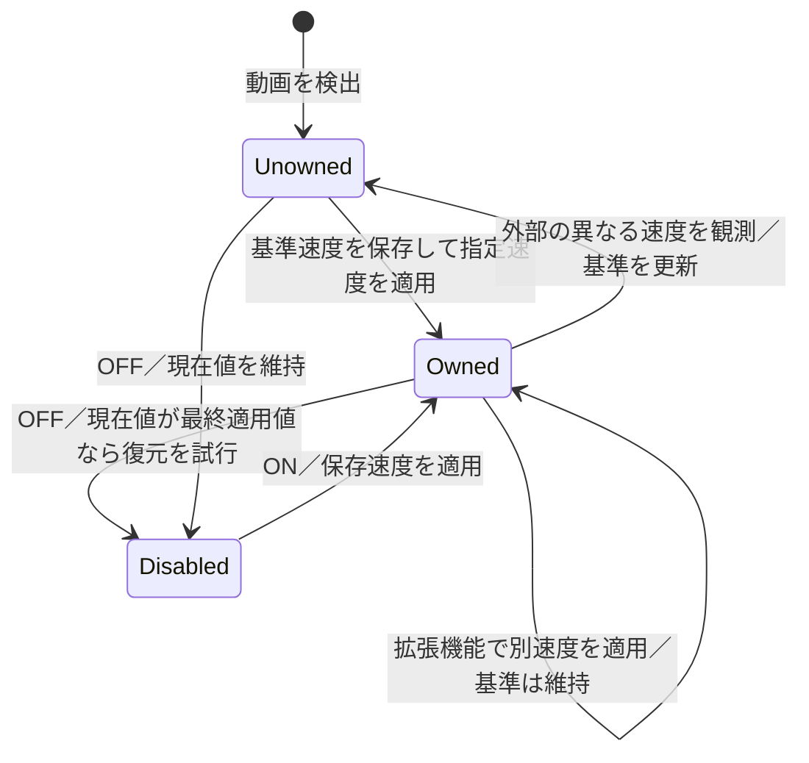
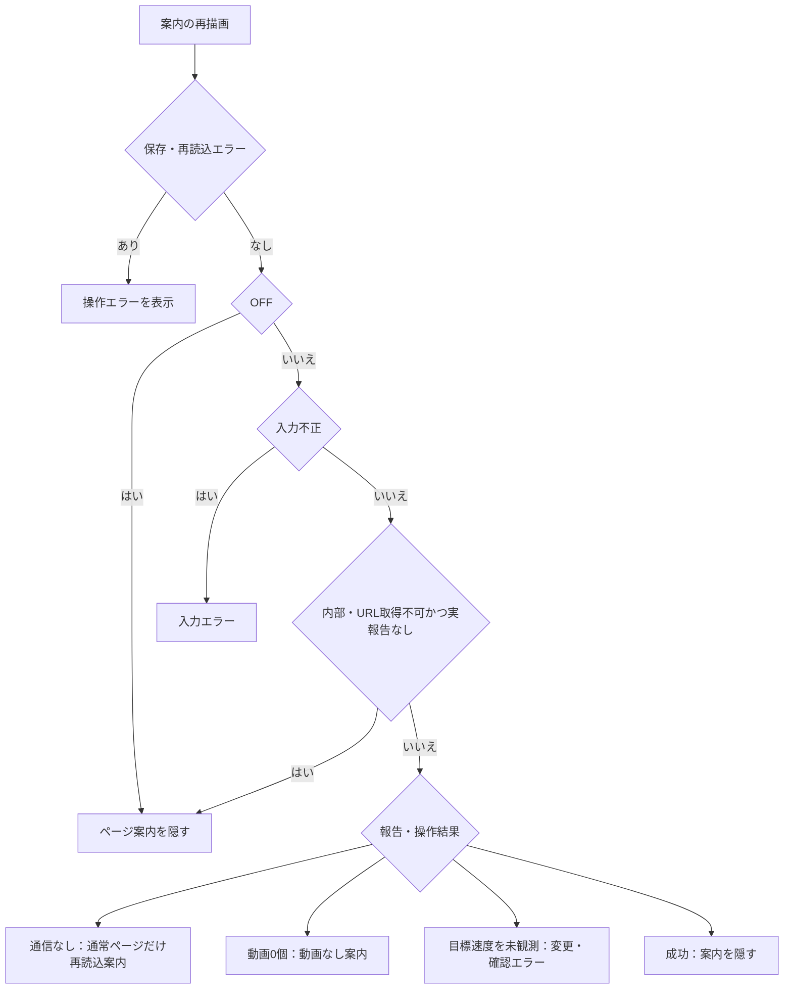
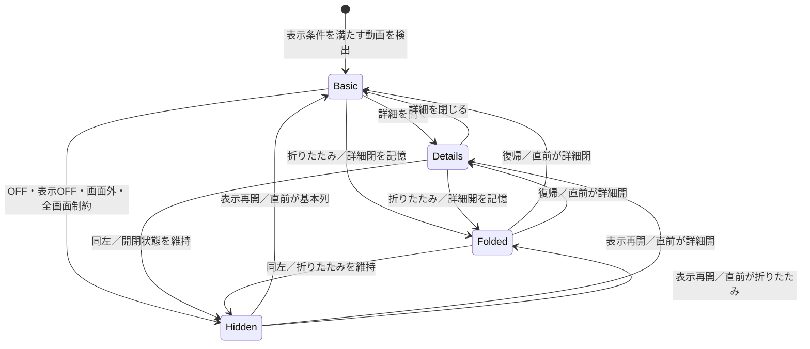
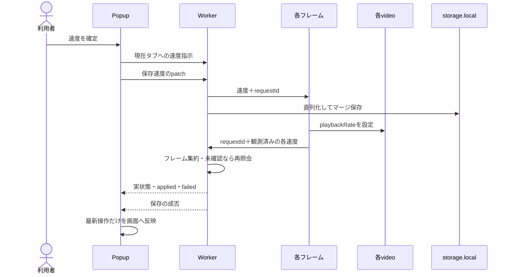

# Claude実装依頼用仕様書：動画再生速度変更

仕様整理日：**2026年10月22日**。仕様基準：既存拡張機能 **1.5.3**。

Chrome / Microsoft Edge 向けデスクトップ拡張機能を、Claudeに新しいプロジェクトで同等に実装してもらうための仕様書である。本書だけを渡して実装できるように、機能、画面、操作対象、設定、通信、異常時の表示、成果物、受入条件を定義する。既存ソースや画像の閲覧は前提としない。

## 0. Claudeへの実装依頼

以下を実装指示として扱うこと。

> この仕様書に従って、Chrome / Microsoft Edgeで使える「動画再生速度変更」拡張機能を作成してください。設計の説明だけで終わらず、読み込み可能なManifest V3の拡張機能、12言語の翻訳、アイコン、テスト、導入説明書、配布ZIPの生成処理まで実装してください。第2章のF01〜F24と第9章のA01〜A35を基準に確認し、実施した検証と未確認の項目を報告してください。

- **機能の完成範囲**：第1〜9章の必須要件を満たす。速度範囲、5つのプリセット、操作対象の違い、OFF時の復元と表示、実速度に基づく判定、12言語、淡い折りたたみアイコンを省略・変更しない。
- **技術の基本方針**：HTML / CSS / JavaScriptによる静的な拡張機能とし、通常利用にサーバー、アカウント、外部CDN、コンパイルを要求しない。テストや配布生成の開発用依存は利用できる。
- **実装上の裁量**：本書の「参考実装値」や推奨の内部構成は、動作契約と外観基準を満たす範囲で変更できる。製品名・配布名・作者リンクは本書の基準値を初期値とする。
- **成果物の置き方**：新規作成時は第8.1節の構成を基本とし、ルートの `manifest.json` があるフォルダーを選んでブラウザーへ読み込める状態にする。未実装のTODOや仮ボタンを完成扱いしない。
- **完了報告**：作成ファイル、導入方法、検証したブラウザーとバージョン、受入項目ごとの結果、残る制約を日本語で記載する。確認できなかった条件は「未確認」とし、既存実装の検証記録を新実装の成功実績として引用しない。

優先して区別する状態は、**保存速度と実速度**、**共通設定と操作対象タブ**、**動画なしと通信なし**、**拡張機能による速度変更とサイト側の速度変更**である。これらを混同すると、別タブの動画の速度変更、OFF時の誤復元、誤った警告につながる。

## 1. 目的・対象・読み方

利用者がWeb動画の再生速度を0.25〜16倍へ変更し、ブラウザー上部と動画上の両方から操作できるようにする。動画の視聴を妨げない外観と、保存した設定値と実際の再生速度を混同させない表示を重視する。

- 対象：デスクトップのChromium系ブラウザー。Manifest V3、Chrome最低119相当のAPIを使用する。
- 対象メディア：アクセス可能なHTML `video` 要素。初期表示、後から追加された動画、open Shadow DOM、許可される埋め込みフレームを含む。
- 対象URL：HTTP、HTTPS、file。fileは利用者が拡張機能の「ファイルのURLへのアクセスを許可」を有効にした場合。
- 制限：ブラウザー内部ページ、拡張機能ストア、閉じたShadow DOM、独自の特殊プレーヤー、サイト側が速度変更を拒否・上書きする場合は操作できないことがある。
- 音声だけの `audio`、字幕加工、ダウンロード、アカウント、クラウド同期、アクセス解析は対象外。

open Shadow DOMは、初期走査で存在するroot内の動画、後から追加されたhostが持つroot内の動画、監視中のroot内に後から追加された動画を対象とする。既存hostに後から `attachShadow()` だけを実行するケースは、上記とは検出条件が異なるため、対応・検証範囲を別途記録する。閉じたShadow DOMへのアクセスは要件に含めない。

**必須要件**は動作・表示の契約であり、表中のIDで受入条件と対応付ける。**外観基準値**は同じ見た目を再現するためのCSS値。**参考実装値**のタイマーやファイル分割は、動作契約を満たす同等実装へ変更できる。全配信サイトでの動作保証は要件に含めない。

| 用語 | 意味 |
| --- | --- |
| 保存速度 | 最後に利用者が選んだ共通設定値。実際の再生速度とは別 |
| 実速度 | `video.playbackRate` から観測した現在の値 |
| 基準速度 | 拡張機能が速度を変更する直前の値。OFF時の復元候補 |
| 所有中 | 現在の実速度が拡張機能の最終適用値と一致する状態 |
| ポップアップ | ブラウザーの拡張機能アイコンから開く幅360pxの画面 |
| 動画上パネル | 動画の左上に重ねる、その動画だけを操作するパネル |
| 詳細展開／折りたたみ | 前者はスライダー等の開閉、後者はパネル全体を小さなアイコンにする操作 |

## 2. 必須機能と初期値

| ID | 要件 |
| --- | --- |
| F01 | 初回は有効ON、保存速度1倍、動画上に表示ON、速度を記憶ON、言語はブラウザーに合わせる自動設定 |
| F02 | 指定速度は0.25〜16倍。確定後は小数第2位までに丸める。数値入力は0.01単位を指定可能 |
| F03 | 数値入力はEnter、change、blurで確定。空欄・非数値・範囲外は適用も保存もしない。Enter後のblurで二重適用しない |
| F04 | スライダーは0.05刻み。−／＋は現在の操作値から0.25増減し、上下限で止める。上下限に達した側のボタンは無効 |
| F05 | プリセットは1、2、4、8、16倍の5個のみ。リセットは1倍。選択中プリセットを色と `aria-pressed` で示す |
| F06 | ポップアップからの速度操作は、現在のタブ内で検出済みの全動画が対象。埋め込みフレームも含む |
| F07 | 動画上パネルからの操作は、その動画1個だけが対象。同ページの別動画や別タブを直接変更しない |
| F08 | ON/OFF、動画上に表示、速度を記憶、保存速度、言語はブラウザー内で共通保存。通常の速度操作だけでは別タブの既存動画を変更しない |
| F09 | OFFで全タブの動画上パネル・倍率バッジを隠し、所有中の動画だけ基準速度へ戻す。ONで全タブの検出済み動画へ保存速度を適用 |
| F10 | OFFの中央表示は翻訳済みOFFに固定。別行に「ON時の設定速度」を表示。「未確認」、現在倍率、復元・通信確認の注記を表示しない |
| F11 | 「動画上に表示」OFFはパネルだけを隠す。速度適用とポップアップ操作は継続できる |
| F12 | 「速度を記憶」ONなら新規検出時と `loadedmetadata` 時に保存速度を適用。OFFなら自動適用しない。切替だけで既存動画の速度は変えない |
| F13 | 速度を記憶OFFでも手動速度は保存する。OFF→ONの有効切替では、記憶設定に関係なく既存動画へ保存速度を適用 |
| F14 | ポップアップのヘッダーとタブ別バッジは取得できた実速度を表示。実状態を取得できないON時のヘッダーはONだけ |
| F15 | 動画上パネルに基本列・詳細欄・折りたたみアイコンを用意。折りたたみ前後で速度と詳細開閉状態を維持 |
| F16 | 折りたたみアイコンは小さく淡い線画とし、通常時は地味にする。ホバー／キーボードフォーカス時だけ背景と線を強める |
| F17 | 自動＋12言語の手動選択を提供。変更を保存し、既存パネル・警告・ラベル・ツールチップへ即時反映。OFF中も言語変更可能 |
| F18 | 通信なし、接続済みで動画なし、速度変更の拒否を区別する。内部ページやURLにアクセスできないタブでは再読み込み案内を出さない |
| F19 | URL情報がなくても実フレーム報告を得た場合は、動画なし・変更拒否などの診断を表示できる。単なる通信不成立を「非対応」と断定しない |
| F20 | 通常ページの再読み込み案内に対象タブだけを再読み込みするボタンを隣接配置。処理中の連打を無効化 |
| F21 | 古い応答・ページ遷移前の報告・別タブの通知で新しい操作結果を上書きしない。設定の別項目同時更新を失わない |
| F22 | キーボード操作、明示ラベル、フォーカス表示、RTLに対応。動画上の操作が親プレーヤーの再生／停止を誤発火させない |
| F23 | URL、視聴履歴、動画状態を外部送信しない。設定は `chrome.storage.local` に保存。不要な権限・実行時外部ライブラリーを追加しない |
| F24 | 新規・削除・移動・全画面・複数フレーム・ワーカー再起動に追従し、古い動画とイベント購読を後処理する |

## 3. 操作対象と速度の所有権

| 操作 | 既存動画への即時作用 | 保存・将来の動画 |
| --- | --- | --- |
| ポップアップの速度選択 | 現在タブの検出済み動画すべて | 共通の保存速度を更新 |
| 動画上パネルの速度選択 | その動画だけ | 共通の保存速度を更新 |
| 保存速度の通知だけを受信 | 他の既存動画を変更しない | 記憶ONなら以後の新規検出・metadataに使用 |
| 有効ON→OFF | 全タブの所有中動画を復元 | 保存速度は維持 |
| 有効OFF→ON | 全タブの検出済み動画に保存速度を適用 | 記憶OFFでもこの切替では適用 |
| 表示設定切替 | 全タブのパネル表示だけ変更 | 設定を保存 |
| 記憶設定切替 | その切替では速度を変更しない | 以後の自動適用可否を保存 |

動画ごとに `baselineRate` と `appliedRate` をメモリーで管理する。初期基準値はその動画の実速度。未所有または実速度が最終適用値と異なる状態で次の速度を適用する直前に、基準値を現在の実速度へ更新する。拡張機能自身が連続で4倍→8倍と変更しても、基準値は最初の値を保つ。

サイトや利用者のネイティブ操作で実速度が最終適用値から変わったら、その値を新基準として所有を解除する。OFF時には「最終適用値あり、かつ実速度との差が0.001未満」の場合だけ基準速度へ復元を試み、その後に所有を解除する。同じ値への外部操作は値だけでは区別できない。setterが例外を投げる等、プレーヤーが復元を拒否する可能性がある。OFF表示は拡張機能が無効であることを示す。

例：元が1.25倍→拡張機能で4倍→OFFなら1.25倍へ戻す。4倍にした後にサイトで1.75倍へ変えた場合は、OFFでも1.75倍を維持する。



## 4. ポップアップ画面

日本語の基本ワイヤーフレーム。数値例は4倍。ONの主入力は、取得後は代表動画の実速度、取得前は操作用の保存値を初期値にする。未取得の保存値をヘッダーやバッジで実速度として扱わない。

```text
ON（幅360px）                         OFF（幅360px）
┌──────────────────────────┐        ┌──────────────────────────┐
│ [ロゴ] 動画再生速度変更 ON·4.00× [●]│        │ [ロゴ] 動画再生速度変更 OFF [○] │
│ ┌──────────────────────┐ │        │ ┌──────────────────────┐ │
│ │ 再生速度        リセット │ │        │ │ 再生速度               │ │
│ │ [−]    4.00 ×    [＋] │ │        │ │          OFF           │ │
│ │ ━━━━━●━━━━━━━━━━━━━━ │ │        │ │ ──────────────────── │ │
│ │ 0.25×           16.00×│ │        │ │ ON時の設定速度    4.00× │ │
│ │ [1×][2×][4×][8×][16×]│ │        │ └──────────────────────┘ │
│ └──────────────────────┘ │        │ 動画上に表示       [●無効] │
│ [必要な場合だけ案内カード]  │        │ 速度を記憶         [●無効] │
│ 動画上に表示          [●] │        │ 🌐 言語         [日本語▼] │
│ 速度を記憶            [●] │        │ [作者の他のアプリ       ↗] │
│ 🌐 言語       [日本語▼] │        └──────────────────────────┘
│ [作者の他のアプリ     ↗] │
└──────────────────────────┘
```

OFF中は速度操作一式とリセットを非表示。表示・記憶スイッチは設定値を保ったまま無効化。言語とマスタースイッチは使用可能。ON/OFF保存中はマスタースイッチと競合する速度操作を無効化する。初期読込が完了するまで入力を有効化しない。保存失敗時は未確定の見た目を保存済み設定へ戻す。

入力編集中の数値は、状態報告、保存応答、言語変更、別項目の切替で上書きしない。プリセット等の明示的な速度選択とON/OFF切替は入力途中値を解消できる。ポップアップの確定値・保存速度は小数2桁、動画上パネルとバッジは末尾の不要な0を省略する。

### 4.1 外観基準値

| 部位 | CSS基準 |
| --- | --- |
| 全体 | `width:360px; margin:0; background:#f7f9f8; color:#182b35`、内側余白18px 22px 15px |
| 書体 | Segoe UI、Yu Gothic UI、Hiragino Kaku Gothic ProN、Meiryo、sans-serif。数字はtabular-nums |
| 基本色 | 強調 `#087f75`、強調ホバー `#07675f`、補助文字 `#62736e`、区切り線 `#e4eae7` |
| ヘッダー | 下余白18px。ブランド17px・太さ750。ロゴ32×32px、角丸10px、背景 `#163a3b` |
| 速度カード | 白、1px枠、角丸19px、余白18px 18px 16px、影 `0 3px 12px rgb(23 48 43 / 3%)` |
| 中央値 | 48px・太さ650、ON入力幅145px、単位24px。OFFは補助文字色、中央配置 |
| 増減ボタン | 36×36px、角丸11px、1px枠。プリセットは高さ32px、5等分、間隔6px |
| スライダー | 高さ6px、つまみ直径18px、白枠3px。下に最小・最大。進捗は線形比率 |
| 設定 | 各行最低44px。スイッチ32×19px、つまみ13px。OFF背景 `#c9d4ce` |
| 言語選択 | 幅170px・最大60%、最低高さ32px、角丸8px。長い訳で横にはみ出させない |
| 案内 | 警告背景 `#fff4dc`、枠 `#d4a85e`、文字 `#73440a`。14px以上、角丸10px |
| エラー | 背景 `#fff0ed`、枠 `#dc9e96`、文字 `#8f2d23`。再読込ボタン32×32px |
| フォーカス | 2px強調色の輪郭。動きを減らす設定ではトランジションを止める |

ヘッダーのブランドマークは21×21pxのSVG、viewBox `0 0 24 24`。白い塗りの三角形は `(8,5)→(18,12)→(8,19)`、左の白線はx=4、y=6〜18、太さ2.4、端を丸める。これを前記32pxの角丸背景の中央に配置する。拡張機能の大小アイコンも同じ意匠で作る。

通常画面、OFF画面、警告・保存エラー画面を、対応する全言語で幅360px・高さ600px以内に収める。作者リンクまで文字欠けや横溢れなく表示する。

### 4.2 案内の判断と優先順位

初期設定読込に失敗した場合は「設定を読み込めませんでした。開き直してください。」を表示して初期化を完了しない。以後の案内は次の上から最初に該当するものを表示する。

| 優先 | 条件 | 日本語表示／再読み込みボタン |
| --- | --- | --- |
| 1 | 設定または言語の保存失敗 | 「設定を保存できませんでした。」／なし。通常の動画通知で消さない |
| 1 | 再読み込みAPI失敗 | 「再読み込みできませんでした。」／許可されるタブで再試行可能 |
| 2 | OFF | ページ状態に関する案内なし |
| 3 | 数値が空欄・非数値・範囲外 | 「0.25〜16の数値を入力してください。」／なし |
| 4 | 内部URL・URL取得不可、かつ実フレーム報告なし | ページ案内なし、再読み込みボタンなし |
| 5 | タブ自体がない | 「操作するタブを確認できません。開き直してください。」／なし |
| 5 | 通常ページで状態報告が得られない | 「ページを再読み込みしてください。」／あり |
| 5 | 変更要求の通信失敗後、再照会でも目標速度を確認できない | 実報告ありなら「再生速度を確認できません。」／なし。報告なしなら前行の扱い |
| 6 | 接続報告あり、動画0個 | 「動画が見つかりません。」／なし |
| 7 | 動画あり、要求後の実速度が目標に一致する動画0個 | 「再生速度を変更できません。」／なし |
| 8 | 上記以外 | 案内なし |

内部ページ判定はアクティブタブの `pendingUrl` を優先し、次に `url` を見る。整数タブIDがあるがHTTP／HTTPS／file以外、またはURLが取得できないときは再読み込みを抑止する。`chrome://extensions`、`edge://extensions` が代表例。URLは判定時のみ使い保存しない。実報告がある場合の動画診断は抑止しないが、再読み込みボタンは抑止を維持する。



## 5. 動画上パネルと小さな復帰アイコン

基本列は「−／実速度（押すと1倍）／＋／詳細展開▾／折りたたみ」。詳細欄は数値入力、エラー、0.05刻みスライダー、範囲、5プリセット。詳細幅236px。展開した通常パネルは背景 `rgba(18,31,35,.94)`、文字 `#f4faf9`、白18%の1px枠、角丸13px、影 `0 5px 22px #0005`、文字13px。通常のボタンは高さ29px。

折りたたみで通常列と詳細欄を隠し、復帰ボタン1個だけを表示する。**再生ロゴ、速度数字、強い色面、影は通常時の復帰ボタンに使わない**。視聴中に視線を奪わず、操作したいときに識別できることが目的である。

| 復帰アイコンの外観 | 必須の再現値 |
| --- | --- |
| 寸法 | ボタン26×26px＋外側パネルの1px枠で外寸28×28px。角丸7px |
| 図形 | 12×12pxの線だけのスライダー／調整記号。塗りつぶしなし、細い線。再生三角形を使用しない |
| 通常 | 背景 `rgba(18,31,35,.24)`、枠 `rgba(255,255,255,.10)`、線 `rgba(255,255,255,.65)`、影なし |
| ホバー・focus-visible | 背景 `rgba(18,31,35,.68)`、枠 `rgba(255,255,255,.18)`、線 `#f4faf9` |
| キーボードフォーカス | 2pxのミント色 `#75e0ce` の輪郭を維持。ポインター操作だけでは強い状態を残さない |
| 説明 | `aria-label` は「コントローラーを開く」。titleは翻訳済みの同文＋現在速度（例：2.55×） |

復帰アイコンの図形基準。CSSで12×12pxに表示し、色は親から継承する。

```html
<svg viewBox="0 0 16 16" fill="none" stroke="currentColor"
     stroke-width="1.3" stroke-linecap="round" stroke-linejoin="round"
     aria-hidden="true">
  <path d="M2 5h3m3 0h6M2 11h6m3 0h3"/>
  <circle cx="6.5" cy="5" r="1.5"/><circle cx="9.5" cy="11" r="1.5"/>
</svg>
```

折りたたみ後は復帰ボタン、復帰後は折りたたみボタンにフォーカスを移す。Enter／Spaceで操作可能。速度と詳細開閉状態を維持し、動画ごとに独立する。折りたたみ状態はページ内メモリーだけに保持し、ページ再読み込み後の復元は不要。`aria-expanded` と `aria-controls` を同期する。

表示条件は有効ON、表示設定ON、動画が画面内、表示幅185px以上・高さ88px以上。非表示・透明・画面外・小さな動画でも、検出されていればポップアップの速度操作対象とする。位置は動画左上から右10px・下10pxを基本に、画面端8px以内にはみ出さないよう補正する。スクロール、リサイズ、レイアウト移動に追従する。

パネルのCSSはページから分離する。推奨は独自要素＋open Shadow DOMと共有スタイルシート。ホストはfixed、最高位相当の重なり順、ホスト自体のpointer-eventsはnone、操作パネルはautoとする。click、double click、pointer down/up、key down/upの伝播を止める。

コンテナーの全画面表示では、その全画面要素内へパネルを移動する。`video` 要素自体を直接全画面にした場合はパネルを隠す。削除動画はResizeObserver、メディアイベント、ホスト要素を破棄。各フレームは二重初期化を防止し、自分のパネルを動画探索に再帰投入しない。



## 6. 言語・バッジ・アクセシビリティ

言語選択肢は `auto` と、`ja` 日本語、`en` English、`ko` 한국어、`zh_CN` 简体中文、`zh_TW` 繁體中文、`es` Español、`fr` Français、`de` Deutsch、`pt_BR` Português (Brasil)、`ru` Русский、`hi` हिन्दी、`ar` العربية。全表示文・エラー・title・ariaラベルをカタログ化する。日本語の基本文言は本書の画面と案内表を基準にする。

日本語以外の翻訳本文は、同じ意味の自然なUI表現として新規作成する。本書に全翻訳本文は収録していないため、既存版との逐語一致は受入条件に含めない。翻訳カタログ間でキー・プレースホルダーを一致させ、未翻訳のキー名を画面へ表示しない。

自動設定はブラウザーの翻訳カタログ／UI言語に合わせる。zhのTW・HK・MO・Hantは繁体、その他は簡体、ptはブラジルポルトガル語、他は対応する基底言語へ解決し、未対応は英語。アラビア語はRTL。他言語はLTR。ポップアップの中央数値表示・スライダー・プリセット・OFF時の保存倍率はLTRを維持する。動画上パネルの行・スライダー・プリセットは選択言語の方向に従う。

言語の保存失敗時に選択を確定しない。初期読込より先に変更を購読し、古い読込が新しい選択を上書きしない。翻訳でDOMを全置換せず、編集中の入力、フォーカス、折りたたみを維持する。管理画面の名称はmanifestのローカライズに従い、アプリ内の手動言語とは別にする。

バッジはタブ別。OFF・動画なしでは空。実速度が `1.5×` のように4文字以下なら単位付き、`3.95×` のように長ければ数値のみ。ツールチップは「動画再生速度変更 · ON · 3.95×」形式。代表動画は各フレーム内で再生中を優先し、その候補内で最後に操作した動画、画面内、先頭の順。フレーム間では再生中、画面内、トップフレームの順。

状態や警告は適切なlive regionに通知し、入力不正は `aria-invalid` を付ける。アイコンだけのボタンにも翻訳済みラベルを持たせる。縮小表示の淡さをキーボードフォーカスに適用せず、フォーカス時の操作箇所は明確にする。ブランド名や長い訳は折り返し、360px幅で横スクロールを発生させない。

## 7. データ・通信・並行処理

永続データの基準スキーマ。キー名を変更する場合は全コンテキストを統一し、既存版を更新する配布では移行処理を用意する。設定スキーマversionは拡張機能のバージョンと別管理。

```json
{
  "tempoSettings": {
    "version": 1,
    "enabled": true,
    "speed": 1,
    "showOverlay": true,
    "rememberSpeed": true
  },
  "tempoLanguage": "auto"
}
```

booleanはboolean型のみ採用し、不正型は初期値。speedは有限数のみ採用し、0.25〜16へ制限して小数2桁へ丸め、不正値は1。未保存・不正な言語設定は自動設定へ戻す。復元速度、動画リスト、URL、折りたたみ、詳細開閉、編集中入力は永続化しない。

推奨構成はポップアップ、Service Worker、フレームごとのコンテンツスクリプト、共有翻訳モジュール。必要権限は `storage`、`activeTab`。content scriptはdocument_idleでHTTP／HTTPS／fileに登録し、all_frames、match_about_blank、match_origin_as_fallbackを有効化。ストア等の制限回避は行わない。

| 論理メッセージ／基準名 | 送信先・意味 |
| --- | --- |
| `TEMPO_SAVE_SETTINGS` | popup/content→worker。許可項目のpatch。応答はokと保存後settings |
| `TEMPO_GET_TAB_STATE` | popup→worker。tabIdを指定し、フレームへ新規照会した集約結果を返す |
| `TEMPO_SET_TAB_SPEED` | popup→worker。tabIdとspeed。速度指示後の実報告とapplied/failedを返す |
| `TEMPO_SET_SPEED` | worker→各content。speedとrequestId。各動画へ適用して実状態を上り報告 |
| `TEMPO_REQUEST_REPORT` | worker→各content。requestId付きの状態照会 |
| `TEMPO_REPORT_STATE` | content→worker。動画数、代表実速度、各速度、再生／可視、文書開始・観測時刻 |
| `TEMPO_GET_STATE` | worker→特定content。バッジ更新時の生存・実状態確認 |
| `TEMPO_TAB_STATE_CHANGED` | worker→popup。tabIdと最新集約状態 |

集約状態は `ok, connected, enabled, videoCount, speed, frames, updatedAt` を持つ。connectedは新鮮な実報告の有無で、動画数と別。frameはframeId、videoCount、speed、rates、playing、visible、startedAt、observedAtを持つ。速度指示のappliedは要求値との差0.001未満の動画数、failedは報告された動画数との差。少なくとも1個が一致すれば一律の変更失敗を出さず、残る動画まで成功したと断定しない。

1. 設定更新はworkerの単一キューに集める。保存直前に既存値を再読込して許可項目だけをマージし、異なる設定の同時更新を保持する。
2. ポップアップの速度指示と保存は即時に送信し、ポップアップを閉じても未送信キューに残さない。応答の片方が失敗してももう片方の結果を失わない。
3. 複数フレームへのブロードキャストが返す1応答だけで結論を出さず、requestIdと観測時刻で上り報告を集約する。無報告と動画0個を分ける。
4. 要求した速度を観測できなければ状態を再照会する。通信応答だけを失った成功を失敗と決めつけない。遅い実報告が来れば表示を回復させる。
5. ポップアップは操作番号と単調なupdatedAtで古い結果を除外し、速度指示・ON/OFF・再読込中の競合通知を採用しない。別タブの保存通知で操作値を動かさない。
6. 文書のstartedAtとobservedAtで古いページの報告を排除。遷移中の速度指示は新ページへ再送せず、状態照会だけ1回再試行できる。
7. 動画消失時は保留中の集約からも取り除く。タブ遷移・削除で古いキャッシュを破棄し、worker再起動時は実フレームから再構築する。
8. 変更拒否の表示は通常のplay/pause通知だけで消さず、目標速度を観測した場合、動画消失、別の明示操作等で解消する。



参考実装値：動画上操作の保存まとめ120ms、削除後処理80ms、content状態報告40ms、popupへの通知25ms、位置更新requestAnimationFrame＋表示中800ms周期。フレーム収集は400msを締切タイマーとし、動画の報告と既知の動画フレームが揃ったら60msの静穏期間後に早期終了する。これらは実時間の保証ではなく、遅延環境では延びる。未応答フレームを成功と扱わない。

## 8. 新規プロジェクトでの成果物・作成手順

最低成果物はmanifest、popupのHTML/CSS/JS、worker、content、共有翻訳、12言語のカタログ、16/32/48/128pxアイコン、説明書、本仕様、検証記録、パッケージ生成処理、ブラウザーテストとローカル動画fixture。実行時外部ライブラリーとコンパイルを必須にしない。

1. 本書の初期値・権限・対応URLでMV3の骨格を作り、ローカル動画1個で速度変更を実装する。
2. 動画ごとの所有権とOFF復元を実装し、複数動画・フレーム・保存設定へ拡張する。
3. ポップアップ、実速度バッジ、動画上パネル、淡い復帰アイコンを外観基準値で作る。
4. 共通翻訳を12言語へ展開し、lang/dir、title、aria、エラーまで切り替える。カタログのキー・空文字・プレースホルダー一致を検査する。
5. 通信欠落、保存失敗、遷移、遅延、同時操作を再現できるテストを用意し、受入条件をChrome系とEdgeの双方で確認する。
6. ZIPを展開すると単一の拡張機能フォルダーがあり、その直下にmanifestが来る形で配布する。開発依存、node_modules、動画fixture、テストコードは同梱しない。

基準構成の開発コマンドは、ルートで `node scripts/build-i18n.cjs`、一致確認に `node scripts/build-i18n.cjs --check`。テストフォルダーで `npm.cmd ci`、`npx.cmd playwright install chromium` 後、`npm.cmd test`、`npm.cmd run test:edge`、`npm.cmd run test:i18n`、`npm.cmd run test:i18n:edge`、`npm.cmd run test:settings`、`npm.cmd run test:settings:edge`、`npm.cmd run test:folded`、`npm.cmd run test:folded:edge` を順番に実行する。配布はルートから `powershell -ExecutionPolicy Bypass -File scripts/package.ps1`。別構成でも同じ目的のコマンドを説明書へ明記する。

自動検証は利用中プロフィールと分けた一時プロフィールへ実拡張機能を読み込み、ローカルHTTPの実動画を操作する。ポップアップ表示だけでなく実playbackRate・storage・バッジを照合する。内部ページ判定は拡張機能アクションの実操作によるactiveTab権限も再現する。検証対象ブラウザーのバージョン、結果、画像、未確認範囲を記録し、修正後の最終差分を再確認する。

製品名は「動画再生速度変更」、既存配布フォルダーは `Tempo`、ZIP名は `Tempo-Chrome-Edge.zip`。作者リンクの基準値は `https://hisator-notebook.com`、新しいタブで開き `noopener noreferrer` を付ける。新規製品へ転用する場合は製品名・ロゴ・配布名・作者リンクを一括置換できる。淡い復帰アイコンにはブランドロゴを流用しない。

### 8.1 成果物の基本構成

```text
project/
├─ manifest.json                 # Manifest V3、権限・対象URL・フレーム設定
├─ background.js                 # 保存の直列化、フレーム集約、タブ別バッジ
├─ content.js                    # 動画検出、速度制御、所有権、動画上パネル
├─ popup.html
├─ popup.css
├─ popup.js                      # ポップアップ操作と状態表示
├─ i18n.js                       # 共通翻訳・言語設定・組み込みカタログ
├─ _locales/
│  └─ <言語コード>/messages.json # 第6章の12言語すべて
├─ icons/                        # icon16/32/48/128.png
├─ scripts/
│  ├─ build-i18n.cjs              # カタログ生成と整合チェック
│  ├─ generate-icons.ps1          # または同目的の再生成手順
│  └─ package.ps1                 # 配布フォルダーとZIPを作成
├─ tests/                        # 実ブラウザーテスト・ローカル動画・実行説明
├─ README.md                     # 導入、更新、操作、権限、制限
├─ SPECIFICATION.md              # 本仕様書
├─ IMPLEMENTATION.md             # 構成・保存・通信・状態遷移の説明
├─ TESTING.md                    # 実施環境・受入結果・未確認項目
└─ dist/                         # パッケージ生成時に作成
   ├─ Tempo/                    # 直下にmanifest.jsonを含む配布フォルダー
   └─ Tempo-Chrome-Edge.zip      # Tempoフォルダーを格納
```

`_locales` は `ja`、`en`、`ko`、`zh_CN`、`zh_TW`、`es`、`fr`、`de`、`pt_BR`、`ru`、`hi`、`ar` の全ディレクトリーを作る。manifestの既定言語は `en`、名前・説明・アクション名は翻訳キーで指定する。新規実装の初期バージョンは基準の `1.5.3` とし、`minimum_chrome_version` は `119` とする。

### 8.2 納品時の検証報告

第9章の各受入項目に対して、少なくとも「項目ID／ブラウザーとバージョン／成功・失敗・未確認／実施方法または証跡／制約」を記録する。実ブラウザーによる自動テスト、実ブラウザーでの手動操作、モックのみの検証を区別する。テスト項目を用意しただけでは成功としない。

クロスオリジンiframe、全画面、Service Worker再起動、サイト固有プレーヤーなど、実行環境で検証できない条件も一覧から削除せず、未確認の理由を残す。修正を加えた場合は、修正を含む最終差分を見直し、影響する受入項目を再検証してから完了報告する。

## 9. 受入チェックリスト

全項目を確認し、結果と制約を残す。該当する項目はChromiumとEdgeで実施する。見た目の項目は明るい動画・暗い動画の双方を含める。

| No. | 対応要件 | 操作・条件と合格基準 |
| --- | --- | --- |
| A01 | F01 | 新規プロフィールで初期値5項目が一致し、1倍で開始 |
| A02 | F02/F03 | 1.23をEnter・blurで確定でき、実速度と保存値が1.23。Enter後blurでも二重指示なし |
| A03 | F03 | 空欄・0.24・16.01・非数値で実速度と保存値が変わらず、入力エラー |
| A04 | F04/F05 | スライダー0.05刻み、増減0.25刻み、上下限、5プリセット、1倍リセットが一致 |
| A05 | F06 | 同タブの2動画と別origin iframeへpopup操作が届く。トップフレームに動画なしでも成功 |
| A06 | F07 | 動画上で1個を2.55倍にすると同ページの別動画・別タブは変わらない |
| A07 | F08 | 他タブの速度保存通知だけでは既存動画とpopupの実速度表示が変わらない |
| A08 | F09 | 元1.25倍→4倍→8倍→OFFで1.25倍に復元、保存速度8倍を維持 |
| A09 | F09 | 4倍適用後サイト側で1.75倍にすると、OFFでも1.75倍を維持 |
| A10 | F09/F10 | OFFで全タブのパネル・倍率バッジが消え、中央OFFとON時保存速度だけを表示 |
| A11 | F10 | 通信断・動画なし・内部ページ・OFF処理中・popup再表示でも「未確認」や復元注記なし |
| A12 | F11 | 表示設定OFFで全パネルが消え、速度とpopup操作は維持 |
| A13 | F12/F13 | 記憶OFFは既存動画を変えず、新規動画・metadataでも自動適用なし。手動値は保存される |
| A14 | F13 | 記憶OFFのままOFF→ONで全タブの既存動画へ保存速度を適用 |
| A15 | F12/F24 | 記憶ONなら追加動画とソース再設定時に保存速度を適用。pause/resumeだけではサイトの速度を奪わない |
| A16 | F14 | ネイティブ速度変更をヘッダー・バッジへ反映。動画なし・OFFでバッジ空、未取得ONは倍率なし |
| A17 | F14 | タブ切替と複数フレームで代表動画優先順位・長いバッジ値・titleが一致 |
| A18 | F15/F22 | 詳細開・2.55倍でEnter折りたたみ→Space復帰。速度・詳細開・フォーカスが維持される |
| A19 | F16 | 復帰外寸28×28px・線画12px・通常24%背景・影なし。再生ロゴ／倍率を表示しない |
| A20 | F16/F22 | マウス離脱で淡い通常状態に戻る。キーボードfocus-visibleでは背景を強め2px輪郭を表示 |
| A21 | F15/F24 | 複数動画・iframeの折りたたみが独立。185×88px未満や画面外は非表示でもpopup操作可能 |
| A22 | F17 | 全12言語を選択・再表示して保存確認。既存パネル、折りたたみtitle、警告へ即時反映 |
| A23 | F17/F22 | 自動設定と未対応言語の英語fallback、アラビア語RTL、popup数値・スライダーのLTR、動画上パネルのRTLを確認。全言語の通常・OFF・警告画面が幅360px・高さ600px以内に収まる |
| A24 | F17/F21 | 入力途中・フォーカス・折りたたみを保って言語変更。保存失敗時は旧選択へ戻りエラー |
| A25 | F18 | chrome://extensions・edge://extensionsで再読み込み文・ボタンを表示しない |
| A26 | F18/F19 | URL取得不可で報告なしなら案内なし。実報告ありなら動画0・変更拒否の診断を維持 |
| A27 | F18/F19 | 通常HTTPで報告なしは再読込案内。接続済み動画0は動画なし。setter拒否は変更エラー |
| A28 | F20 | 再読込は対象タブ1個だけ。連打1回、失敗後に再試行可。古い通知が結果を戻さない |
| A29 | F21 | 速度指示後の応答欠落でも実速度成功を再照会で確認し、誤って変更失敗にしない |
| A30 | F21 | 遅延iframe・iframe交換・遷移前報告・動画削除で古いキャッシュや最初の空応答を採用しない |
| A31 | F21 | 保存速度と表示設定等の同時更新を両方保持。古い応答で最新の速度選択を戻さない |
| A32 | F21 | 保存失敗を動画の正常通知で消さず、変更拒否もplay/pauseだけで消さない |
| A33 | F22/F24 | 親プレーヤーへのイベント伝播なし、コンテナー全画面のパネル、video直接全画面の非表示を確認 |
| A34 | F23/F24 | worker再起動から実状態再構築。URL・視聴情報の永続化／外部送信なし。削除時購読を解放 |
| A35 | F23 | ZIPを新規展開して両ブラウザーへ読み込め、12カタログ・アイコン・資料が揃い、開発依存を含まない |
